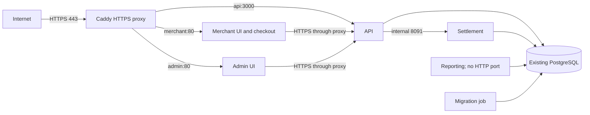

# Deploy on Dilmune Cloud

This Compose setup runs the API, merchant UI (including checkout), admin UI, settlement daemon and reporting worker. It uses your existing PostgreSQL database. The migration job runs first and exits after applying pending migrations.

This is a demo application: its acquirer is simulated and OTP delivery is a stub. OTP delivery is not implemented; normal sign-in requires an OTP delivery integration. The current demo server has `OTP_DEV_EXPOSE=true`, which displays codes in the login screens and disables the protection of the second factor. Do not use real card data.

## 1. Copy the project to the server

Install Docker Engine and the Docker Compose plugin on the server, and make sure Docker is running. Confirm `docker --version` and `docker compose version` work, and that your SSH user can run `docker ps` (otherwise run the Docker commands below with `sudo`). The server needs internet access to download base images and dependencies, plus enough disk space for builds and persistent data. Your local machine needs `tar`, `scp` and SSH access.

From your computer, substitute your SSH user and host:

```sh
COPYFILE_DISABLE=1 tar --exclude='._*' --exclude=.git --exclude=node_modules --exclude='*/node_modules' --exclude='*/dist' --exclude='.env*' --exclude=data -czf /tmp/filspay-deploy.tar.gz .
scp /tmp/filspay-deploy.tar.gz USER@SERVER:~/
ssh USER@SERVER
mkdir -p ~/filspay
cd ~/filspay
tar -xzf ~/filspay-deploy.tar.gz
```

Review your working tree for other sensitive files before copying it. Repeat the archive and copy steps when updating the application. They do not remove files deleted from the source, so use a clean release directory for updates where files were removed.

## 2. Configure

```sh
cp ops/server.env.example ops/.env.server
chmod 600 ops/.env.server
```

Edit `ops/.env.server` on the server. Set `DATABASE_URL` to the existing database, percent-encoding special characters in the username and password. If PostgreSQL runs on the Docker host, `host.docker.internal` refers to that host; PostgreSQL must accept connections from Docker's bridge. If the database is remote, configure TLS as required by its provider. The example contains no credentials and does not enable TLS by itself. Do not use `localhost` or `127.0.0.1` for a database running on the server: inside a container they refer to that container. For a remote provider, verify that both the Node and Go containers trust its CA; a private CA requires additional image configuration. The database role needs permission to create and alter the required schema objects and run the migrations. Confirm the database server's firewall and PostgreSQL access rules allow connections from the containers.

Generate `SETTLEMENT_INTERNAL_TOKEN` with `openssl rand -hex 32` and `WEBHOOK_SECRET_ENCRYPTION_KEY` with `openssl rand -base64 32`. Use your acquirer's signing secret for `ACQUIRER_CALLBACK_SIGNING_SECRET`. Keep the generated values stable across restarts and releases; losing or changing the webhook key makes existing encrypted webhook secrets unreadable. Store them in the protected server file or your platform's secret store, and back up the webhook key. Do not commit or send the populated env file.

Set `MERCHANT_DOMAIN`, `ADMIN_DOMAIN`, `API_DOMAIN`, `CORS_ORIGINS`, `CHECKOUT_BASE_URL` and `VITE_API_BASE_URL` to the HTTPS hostnames used by Caddy. Use subdomains of the same site for browser cookies. `CHECKOUT_BASE_URL` is the merchant origin without a trailing slash; `VITE_API_BASE_URL` is the API origin. Changes to the UI URLs require rebuilding the images.

Before starting, check the Compose configuration without printing its secrets:

```sh
docker compose --env-file ops/.env.server -f ops/compose.server.yml config --quiet
```

This checks configuration syntax and required fields, but does not check that placeholder values were replaced, that the database is reachable, or that URLs are correct. Do not publish the output of `docker compose config` without `--quiet`: it includes secrets.

## 3. Start

From `~/filspay`:

```sh
docker compose --env-file ops/.env.server -f ops/compose.server.yml up -d --build
```

The first start applies migrations to your database. Back up any existing data first; do not run the development seed against an existing database. All five long-running services use `restart: unless-stopped`. The API and both UIs have HTTP health checks; settlement and reporting have no HTTP health endpoints, so check their container state and logs. Docker health status alone does not automatically restart an unhealthy container.

```sh
docker compose --env-file ops/.env.server -f ops/compose.server.yml ps
docker compose --env-file ops/.env.server -f ops/compose.server.yml logs --tail=100
```

The API's `/healthz` checks liveness; `/readyz` reports whether it connected to the database at startup, but does not detect a later outage. KYC uploads are stored in the `kyc_data` Docker volume; back it up along with the database and webhook encryption key. Do not remove the volume during updates.

## 4. HTTPS proxy and live URLs

Compose runs Caddy on the server on ports 80 and 443. It obtains and renews HTTPS certificates automatically; keep both ports publicly reachable and back up the `caddy_data` volume. No Dilmune reverse proxy or host Nginx configuration is needed. Set `MERCHANT_DOMAIN`, `ADMIN_DOMAIN` and `API_DOMAIN` in `ops/.env.server` to the hostnames, and set the URL and CORS variables to match. The current deployment uses:

| Service | URL | Container upstream |
| --- | --- | --- |
| Merchant dashboard | https://merchant.139-59-92-10.sslip.io/dashboard | merchant:80 |
| Checkout | https://merchant.139-59-92-10.sslip.io/pay/<payment-link-token> | merchant:80 |
| Admin | https://admin.139-59-92-10.sslip.io/ | admin:80 |
| API | https://api.139-59-92-10.sslip.io/healthz | api:3000 |

A real checkout URL requires a created test payment link. The domains encode the current server IP; if the IP changes, update the hostnames and all corresponding URL settings and rebuild the UIs. The three applications also remain available on server loopback ports 5173, 5174 and 3000. Settlement stays internal to Compose and reporting has no HTTP port.

Check the public URLs and use `docker compose --env-file ops/.env.server -f ops/compose.server.yml logs --tail=100 proxy` if certificate issuance fails. Check the other service logs if an upstream is unavailable. An empty database has no merchant or admin accounts or test payment links; production OTP delivery is also a stub; for an isolated demo, setting `OTP_DEV_EXPOSE=true` displays the code in the login screen. Anyone with a password can then obtain the OTP, so use this only for demo data and disable it when an OTP delivery integration is ready. Do not run the destructive development seed against an existing database.



The database port is defined by `DATABASE_URL` (PostgreSQL commonly uses 5432). Only the reverse proxy is intended to face the internet.

## Updates and settlement

The start command is also the general redeploy command after copying new source, but **it can recreate settlement and interrupt a run**. The daemon cancels in-flight work on termination. For updates that do not change settlement or require a schema migration, leave the settlement container running and update only the other services after reviewing the changes:

```sh
docker compose --env-file ops/.env.server -f ops/compose.server.yml up -d --build --no-deps api merchant admin reporting
```

For changes to settlement or the database schema, coordinate a maintenance window and confirm no settlement or manually triggered batch is in progress before running the general command. There is currently no automatic drain or authoritative busy indicator, so this is an operational procedure rather than an automated guarantee. Individual database transactions roll back on interruption; a full multi-merchant run is not a single transaction. The daemon retries the most recent business day after restart; an outage spanning multiple business days requires backfilling older dates.

The Dilmune [API documentation](https://docs.dilmune.com/) also describes per-site deploy hooks. They do not by themselves establish that this multi-service Compose deployment is updated safely.

## If a migration fails on a `._*.sql` file

Files beginning with `._` are macOS AppleDouble metadata, not SQL migrations. Some macOS archives can add them when files are copied to Linux. In the server checkout, inspect and remove these metadata files from the migration directory, then rebuild and retry:

```sh
find db/migrations -type f -name '._*.sql' -print
find db/migrations -type f -name '._*.sql' -delete
docker compose --env-file ops/.env.server -f ops/compose.server.yml up -d --build
```

The migration runner commits each migration separately and tracks successful ones, so retry skips those already applied. Removing the metadata files does not delete actual migration files. The archive command above disables macOS metadata and the Docker build excludes AppleDouble files to prevent recurrence.

## If `npm ci` fails looking for Python

You do not need to run `npm ci` on the host for this Compose deployment. Docker runs it inside the image, and `ops/Dockerfile.node` installs Python 3, `make` and a C++ compiler for native dependencies such as `argon2`. The UI image installs only the UI workspaces. Make sure the server has the latest project files, including both Dockerfiles, then retry the Compose start command above.

If the failure occurred while you were running `npm ci` directly on a Debian or Ubuntu host for a non-Docker workflow, install the native build tools first:

```sh
sudo apt-get update
sudo apt-get install python3 make g++
npm ci
```

If the Docker build itself still reports missing Python, check the first error in the build output and which Dockerfile and `RUN npm ci` step failed; it may be using an older copy of the project. Avoid sharing environment values or credentials with logs.

## Local smoke test

You can run the same services locally with a separate, disposable PostgreSQL database. Docker and Compose **2.24.4 or newer** must be running. This setup uses ports 13000, 15173 and 15174 to avoid the usual development ports; check that those ports are free. It uses a separate Compose project and does not connect to the server database.

From the repository root:

```sh
docker compose -p filspay-local --env-file ops/local.env.example -f ops/compose.server.yml -f ops/compose.local.yml up -d --build
```

The first build downloads images and dependencies and can take a while. When it finishes, check:

```sh
docker compose -p filspay-local --env-file ops/local.env.example -f ops/compose.server.yml -f ops/compose.local.yml ps
curl -fsS http://localhost:13000/healthz
curl -fsS http://localhost:13000/readyz
```

Open `http://localhost:15173` for the merchant UI and `http://localhost:15174` for the admin UI. The local database starts empty; this verifies startup and basic routing, not a complete checkout or login. Production-mode OTP delivery is still a stub and secure cookies require HTTPS, so sign-in does not work with this HTTP smoke test. The local credentials are public test values and must not be used for real data.

To inspect failures:

```sh
docker compose -p filspay-local --env-file ops/local.env.example -f ops/compose.server.yml -f ops/compose.local.yml logs --tail=100
```

To stop the local test while retaining its separate database and KYC volumes:

```sh
docker compose -p filspay-local --env-file ops/local.env.example -f ops/compose.server.yml -f ops/compose.local.yml down
```

Do not add `-v` unless you intend to delete the local test database and uploads. The local override is only for testing; do not include it in server deployment commands.
