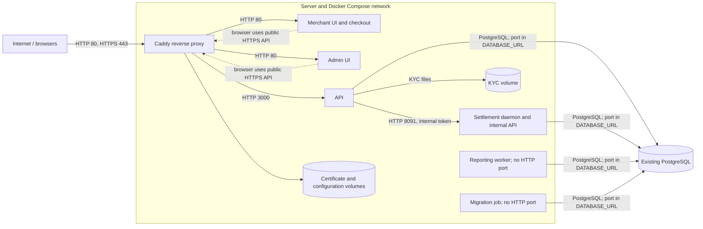

# Architecture and deployment

FilsPay runs as a Docker Compose project on the Dilmune server. Caddy is the public entry point; PostgreSQL is an existing database configured separately from the Compose stack. The merchant application also serves checkout.

**Proxy:** The deployment uses Caddy as its internet-facing reverse proxy, as shown below. It terminates HTTPS and forwards requests by hostname to the merchant UI, admin UI or API over the Compose network. This is the proxy in the deployed stack; no separate Dilmune or host Nginx proxy is configured by this Compose setup.



| Service | Ports and exposure | Purpose |
| --- | --- | --- |
| Caddy | Host **80 and 443**, internet-facing; 2019 internal administration port is not published | Routes the three hostnames and manages HTTPS certificates. |
| Merchant UI / checkout | Container 80; host `127.0.0.1:5173` | Static merchant dashboard and checkout, also routed through Caddy. |
| Admin UI | Container 80; host `127.0.0.1:5174` | Static administration interface, also routed through Caddy. |
| API | Container 3000; host `127.0.0.1:3000` | HTTP API, also routed through Caddy. |
| Settlement | Container 8091, Compose network only | Daily settlement and token-protected internal operations; no host port is published. |
| Reporting | No HTTP port is configured or published | Consumes database outbox events and maintains reporting tables. |
| Migrate | No HTTP port; runs to completion and exits | Applies pending schema migrations before dependent services start. |
| PostgreSQL | External to this Compose file; host and port come from `DATABASE_URL` (often 5432) | Persistent data store. Its firewall and exposure depend on its separate configuration. |

The UI and API host ports bind to loopback, not the public network. Caddy exposes the applications through HTTPS hostnames; port 80 supports HTTP-to-HTTPS handling and certificate issuance. Database accessibility is configured separately and should be restricted to trusted clients.

## Redeployment

After preparing a clean release directory containing the source and a protected `ops/.env.server`, run the following from that release directory to build and start the complete stack:

```sh
docker compose -p ops --env-file ops/.env.server -f ops/compose.server.yml up -d --build
```

Compose is the infrastructure-as-code definition; this command does not copy source to the server or provision PostgreSQL. The migration job applies pending migrations before dependent services start. Back up the database before a schema change. The currently deployed release directory is `~/filspay-releases/d0f631d`; the older `~/filspay` directory is not the active release. For a new release, use its own clean directory and the same Compose project name, `ops`, to retain the intended project and volumes.

**This full-stack command can interrupt settlement.** For changes that do not affect settlement or require a schema migration, keep settlement running and update only the other application services:

```sh
docker compose -p ops --env-file ops/.env.server -f ops/compose.server.yml up -d --build --no-deps api merchant admin reporting
```

For settlement or schema changes, coordinate a maintenance window, confirm no scheduled or manually triggered settlement is in progress, back up the database, then deploy. There is no automatic drain or authoritative busy indicator, so this is an operational check, not a guarantee. A terminated run may roll back individual database transactions; a multi-merchant run is not one transaction. After restart the daemon retries the most recent business day, but older missed days need backfilling. The deployment of `d0f631d` used a brief maintenance period, a verified pre-migration database backup and migration `0084`.

## Secrets and configuration

The server's `ops/.env.server` is a private, operator-managed file supplied to Compose with `--env-file`; it is ignored by Git. The checked-in `ops/server.env.example` contains placeholders, not deployment credentials. The operator supplies the database connection, generates `SETTLEMENT_INTERNAL_TOKEN` and `WEBHOOK_SECRET_ENCRYPTION_KEY`, and supplies the acquirer callback signing secret. The token authenticates API-to-settlement requests; the webhook key protects stored webhook secrets. Keep the webhook key stable and backed up, since changing or losing it prevents decryption of existing secrets. Caddy stores certificate state in its persistent volume. Never commit the populated environment file or publish expanded Compose output; use `docker compose ... config --quiet` for a syntax check.

## Health, restarts and verification

- The API's Docker health check calls `/healthz`; `/readyz` reports whether its database connection succeeded at startup, but does not detect a later outage.
- Each UI's Docker health check requests its local HTTP root. Settlement and reporting have no HTTP health checks; inspect their container state and logs.
- Caddy, API, merchant UI, admin UI, settlement and reporting use `restart: unless-stopped`; the migration job uses `restart: "no"`. Docker does not restart a container solely because its health status is unhealthy.
- Check `docker compose -p ops --env-file ops/.env.server -f ops/compose.server.yml ps` and `docker compose -p ops --env-file ops/.env.server -f ops/compose.server.yml logs --tail=100`, plus the public merchant, admin and API URLs. Back up the database, `kyc_data`, `caddy_data` and the webhook encryption key.

This is a demo: the acquirer is simulated and OTP delivery is a stub. The current demo configuration exposes OTP codes to the login screens; that disables the second-factor protection and must be restricted to demo data. Do not use real card data.
