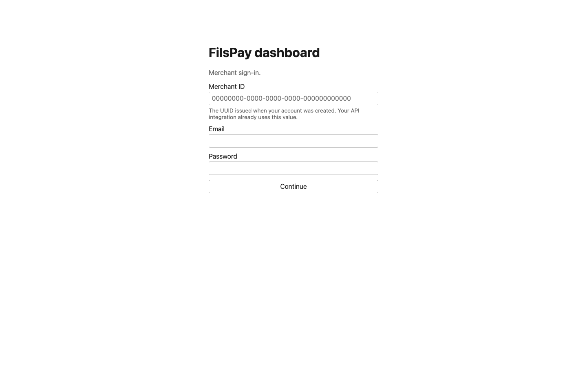
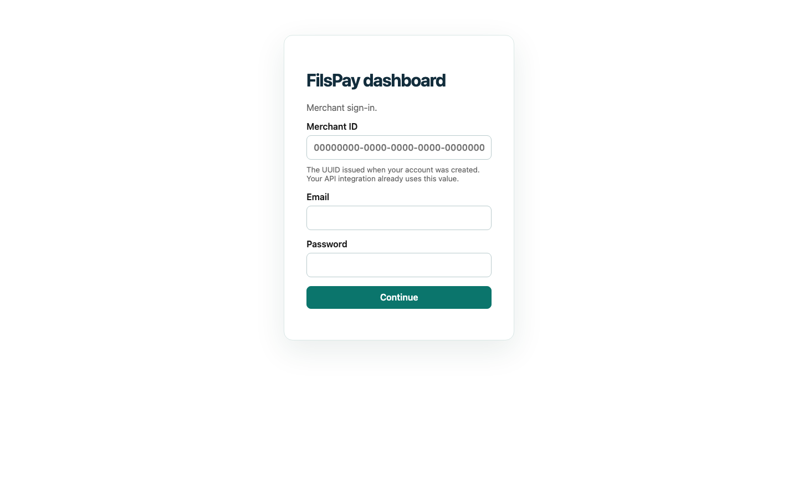
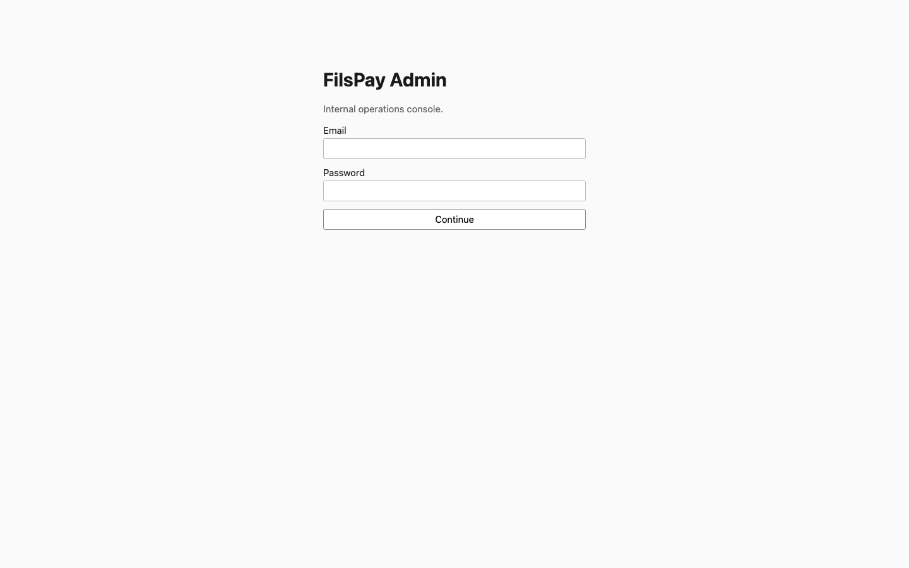
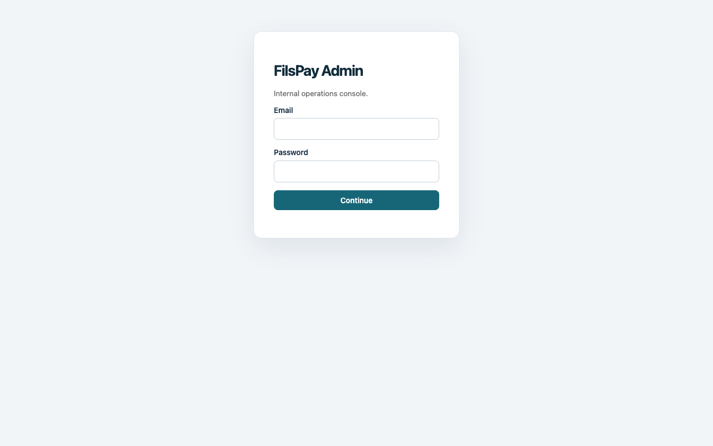

# Portal UI before and after

The images show the merchant and admin sign-in screens using the same 1440 × 900 viewport. They were captured from the local application before and after the styling update.

## Merchant portal

### Before

### After

## Admin portal

### Before

### After

